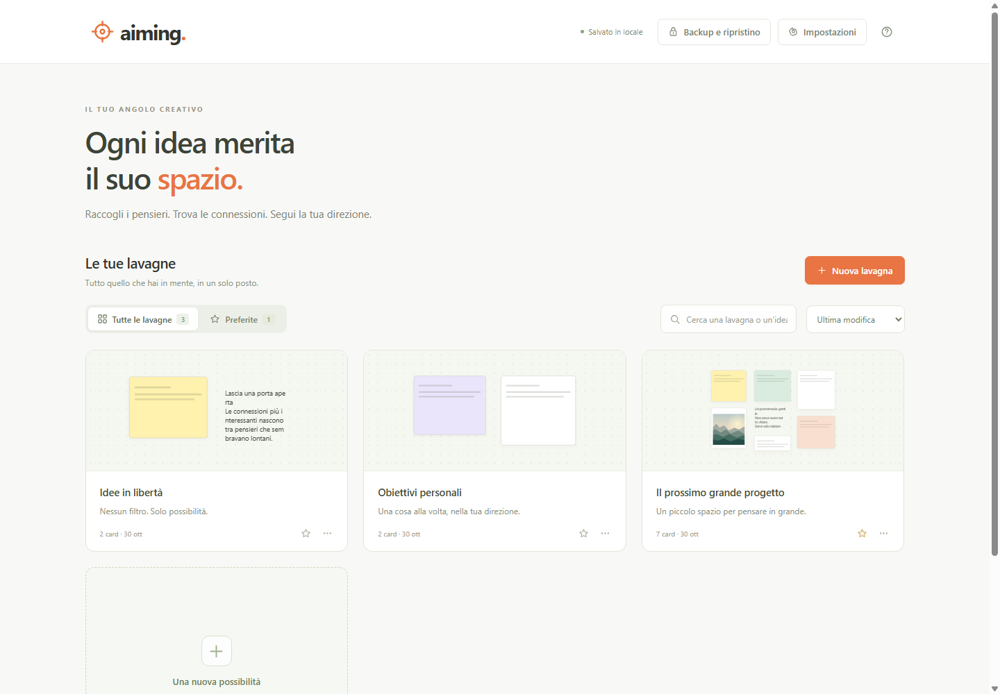
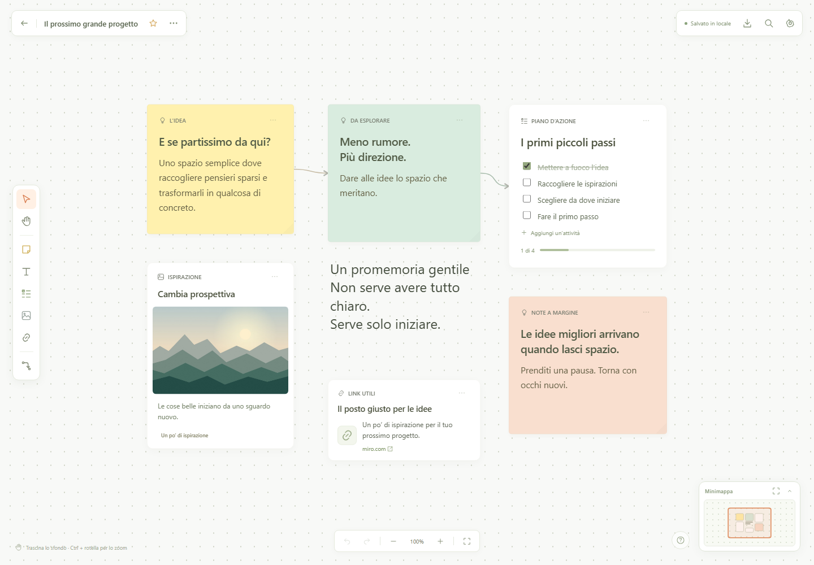

<p align="center">
  
</p>

# Aiming

[Apri Aiming su GitHub Pages](https://carellice.github.io/aiming/)

Il sito viene pubblicato automaticamente da GitHub Actions a ogni push su `main`. Viene servita soltanto la cartella `dist`; i contenuti delle lavagne restano nel browser. Per trasferire le lavagne dal precedente indirizzo, esporta un backup e reimportalo su GitHub Pages.

Uno spazio personale per raccogliere e organizzare le idee su più lavagne infinite. L’interfaccia è in italiano e include post-it, testi liberi, checklist, immagini e link.

## Screenshot

La home e una lavagna con i contenuti di esempio inclusi nell’app.

### Le tue lavagne



### Uno spazio per le idee



## Avvio locale

Richiede Node.js aggiornato. Non ci sono dipendenze da installare né una compilazione da eseguire.

Apri PowerShell nella cartella del progetto:

```powershell
git clone https://github.com/carellice/aiming.git
cd aiming
npm start
```

Apri [Aiming in locale](http://127.0.0.1:4173) nel browser. Per arrestare il server premi `Ctrl+C` nel terminale.

Usa il server locale: aprire direttamente `dist/index.html` dal disco non offre il contesto corretto per i moduli JavaScript e la cifratura del browser. La cifratura richiede HTTPS oppure localhost.

## Cosa puoi fare

- Creare, rinominare, duplicare, eliminare e aggiungere ai preferiti più lavagne.
- Aggiungere post-it, testi, checklist, immagini e collegamenti web.
- Spostare e ridimensionare le card, scegliere i colori e assegnare un’etichetta.
- Collegare due card con una freccia e rimuovere i collegamenti.
- Spostarti nella lavagna, cambiare zoom, adattare la vista e navigare dalla minimappa.
- Cercare tra tutte le lavagne e i contenuti delle card.
- Annullare e ripetere le modifiche durante la sessione.
- Incollare testo e immagini oppure trascinare immagini sulla lavagna.
- Personalizzare il colore dello sfondo e scegliere puntini, griglia o sfondo pulito.
- Esportare e ripristinare tutte le lavagne, immagini comprese, con un backup JSON cifrato.

Al primo avvio vengono create tre lavagne di esempio, modificabili o eliminabili. Il pulsante di aiuto nella lavagna mostra le scorciatoie disponibili.

## Home e scrittura sulla lavagna

La home raccoglie tutte le lavagne, con anteprime, filtro **Preferite**, ricerca e ordinamento. Da qui puoi creare una lavagna, gestire i preferiti, aprire **Impostazioni** e usare **Backup e ripristino**.

Aprendo una lavagna, il canvas occupa tutta la pagina. I controlli restano flottanti e la freccia in alto a sinistra riporta alla home. Non ci sono una barra laterale o testi introduttivi fissi sul canvas.

Per aggiungere un **post-it** o un **testo libero**, scegli lo strumento oppure premi `N` o `T`: il contenuto compare subito sulla lavagna, pronto per scriverci. Il post-it ha un titolo facoltativo. Il testo libero ha un solo campo, senza sfondo, etichetta o contenitore visibile. Un doppio clic sullo sfondo crea un post-it nel punto scelto.

Selezionando un testo trovi la barra di formattazione: carattere sans serif, serif o monospace, dimensione da 8 a 160 px, grassetto, corsivo, sottolineatura, allineamento e colore del testo. Lo **sfondo del testo è disattivato per impostazione predefinita**: puoi attivarlo con il pulsante Sfondo e scegliere un colore. Per spostare un testo trascina la piccola maniglia che compare accanto quando lo selezioni; l’angolo ridimensiona la larghezza. Puoi usare `Ctrl/⌘+B`, `Ctrl/⌘+I` e `Ctrl/⌘+U` mentre scrivi. La formattazione viene salvata anche nei backup. I titoli e i corpi dei testi precedenti restano visibili in un unico campo, senza perdere contenuti.

Per spostare un post-it o un’altra card, trascinane il bordo o l’intestazione; trascinare nel testo serve a selezionarlo. Il pulsante con i tre puntini sulla card apre i dettagli, mentre la barra della card selezionata permette di cambiare colore, duplicare, collegare o eliminare. Il salvataggio resta automatico durante la scrittura.

Il **tasto destro su una card** apre il menu rapido per modificarla, personalizzarla, duplicarla o eliminarla, anche quando stai scrivendo nel testo. Puoi annullare un’eliminazione con `Ctrl+Z` (`⌘Z` su Mac). Sullo sfondo, il tasto destro permette di creare un post-it o un testo nel punto scelto e di adattare la vista. Usa le frecce per muoverti nel menu ed `Esc` per chiuderlo.

## Spostarsi con la minimappa

La minimappa in basso a destra si ingrandisce passando il cursore e torna compatta quando ti allontani. Su touch puoi aprirla dal pulsante **Espandi minimappa**. Il riquadro arancione indica la porzione visibile della lavagna, anche quando ti sposti lontano dalle card.

Clicca un punto della mappa per centrare lì la vista oppure trascina il riquadro arancione per navigare con precisione. Durante il trascinamento la scala rimane stabile. Nella mappa espansa trovi anche zoom e **Mostra tutta la lavagna**. Con la minimappa a fuoco puoi usare le frecce per spostarti, `Maiusc` per passi più grandi, `+` e `-` per lo zoom ed `Esc` per chiuderla.

## Dove sono salvati i dati

Il salvataggio automatico usa **IndexedDB**, con ripiego su **localStorage** quando IndexedDB non è disponibile. I contenuti restano nel browser: non esistono account dell’app, sincronizzazione o un archivio remoto dei contenuti delle lavagne.

I dati sono separati per browser, profilo e origine web. Per esempio, `http://127.0.0.1:4173`, `http://localhost:4173` e un eventuale indirizzo HTTPS ospitato hanno archivi distinti. Per ritrovare le lavagne torna allo stesso indirizzo e usa lo stesso profilo del browser, oppure trasferisci un backup.

Cancellare i dati del sito, eliminare il profilo o chiudere una sessione privata può rimuovere i contenuti locali. Lo spazio disponibile dipende dal browser; localStorage ha generalmente una capacità inferiore a IndexedDB. In caso di errore di salvataggio l’app mostra un messaggio e consente di esportare i contenuti ancora presenti nella sessione, entro i limiti del formato.

## Backup cifrati

Apri **Backup e ripristino** dalla home oppure dal pulsante di backup della lavagna, scegli una password di almeno **8 caratteri** e confermala. Il file JSON esportato contiene i dati cifrati con **AES-256-GCM**. La chiave viene derivata dalla password mediante **PBKDF2 con SHA-256 e 600.000 iterazioni**, con un salt e un vettore di inizializzazione casuali per ogni esportazione.

Per ripristinare, seleziona il file JSON e inserisci la stessa password. Puoi:

- **Aggiungere alle lavagne presenti**, opzione predefinita: il backup viene importato come nuove lavagne senza sostituire quelle esistenti.
- **Sostituire tutti i dati**: il contenuto del backup prende il posto dello spazio attuale.

Un file non valido o una password errata non sostituiscono i dati correnti. Conserva la password separatamente: **non esiste un recupero della password**.

La password protegge **il file esportato**. L’archivio locale del browser **non è cifrato dall’app** e l’apertura della lavagna non richiede una password.

## Immagini e limiti

Puoi caricare immagini PNG, JPEG, WebP, GIF e AVIF fino a **20 MB per file**. Le immagini vengono convertite in PNG e ridimensionate mantenendo le proporzioni, con un lato massimo di **2.048 pixel**; l’eventuale animazione viene convertita in un’immagine statica. I contenuti vengono incorporati nei dati per essere inclusi nel backup.

Il payload complessivo del workspace salvato ed esportato può raggiungere **40 MB**, salvo limiti inferiori imposti dallo spazio disponibile nel browser. La cifratura e la codifica Base64 rendono il file JSON di backup più grande del payload originale. Per mantenere lo spazio veloce e trasferibile, riduci o rimuovi le immagini che non servono.

## Verifica e struttura

```powershell
npm test
npm run check
```

`npm test` esegue i test automatici; `npm run check` controlla la sintassi dei moduli principali. Il codice dell’app è nella cartella `dist`; `server.mjs` serve i file statici per l’uso locale. Non è richiesto alcun servizio esterno o pacchetto di terze parti a runtime.
